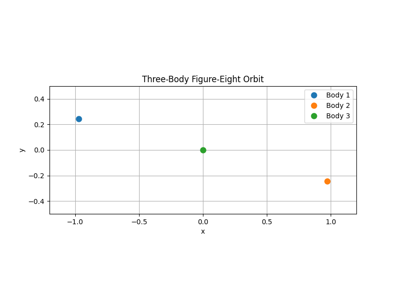
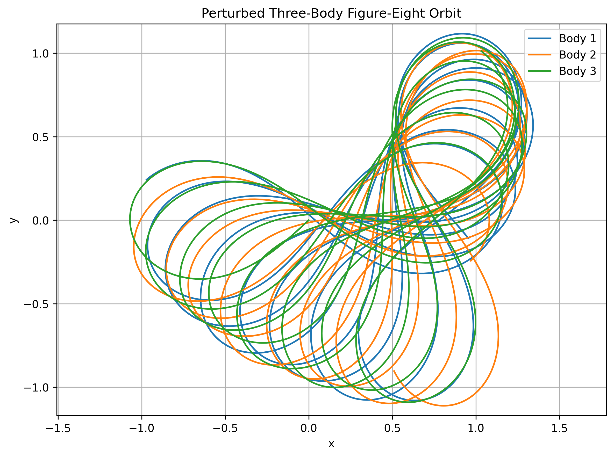
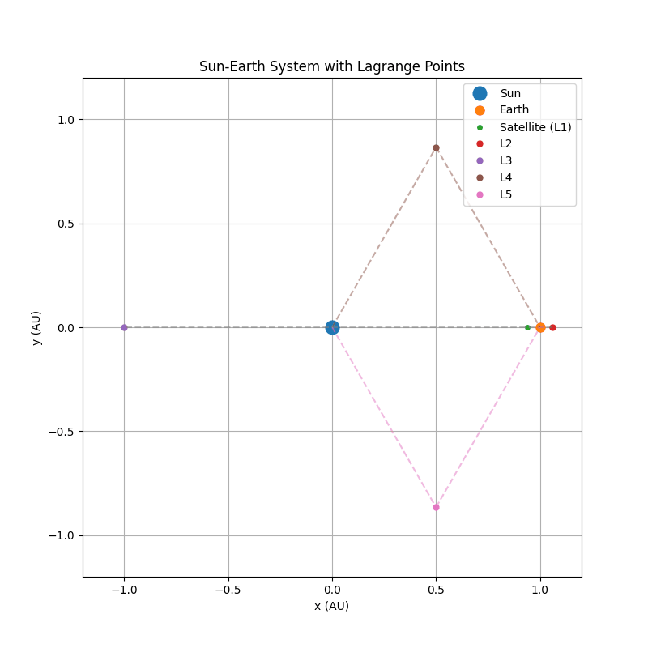

# ODE-Numerical-Methods
A collection of C++ implementations and mathematical studies of numerical methods for ordinary differential equations (ODEs). This project explores the theoretical foundations of numerical algorithms, including existence and uniqueness, continuous dependence on initial conditions, and convergence analysis.

The repository covers initial value problems (IVPs), boundary value problems (BVPs), and numerical simulations of dynamical systems.

## What's Covered

Each method includes not only a C++ implementation but also the mathematical concepts behind the algorithm.

### 1. Theoretical Foundations
- Lipschitz condition
- Existence and Uniqueness Theorem
- Continuous Dependence on Initial Conditions

### 2. Initial Value Problems (IVP)
- Euler's Method
- Explicit Trapezoidal Method
- Midpoint Method
- Runge-Kutta Methods

### 3. Boundary Value Problems (BVP)
- Finite Difference Method (FDM)
- Finite Element Method (FEM)

## Figure-Eight orbit
This is a periodic, symmetric orbit in which the three bodies follow a figure-eight trajectory in the plane. The three bodies chase one another along the same figure-eight-shaped curve.
<p align="center">
  
</p>

## Perturbed Figure-Eight Orbit
The figure-eight orbit is a special periodic solution of the three-body problem. Its periodic motion depends strongly on the initial conditions. To demonstrate this sensitivity, a small perturbation of +0.05 is added only to the x-component of Body 1's initial velocity.


Although only one component of the initial conditions is changed, the trajectories gradually deviate from the original periodic figure-eight orbit, demonstrating the sensitivity of the three-body system to initial conditions.
<p align="center">
  
</p>

## Sun-Earth Lagrange Point Orbits
We consider the Sun-Earth system and place a satellite at L1. The five Lagrange points are locations where the gravitational effects of the Sun and Earth, together with the rotating-frame effect, allow a small object to remain stationary relative to the Sun and Earth in the ideal circular restricted three-body model.

**Note:** Since L1 and L2 are very close to the Earth compared with the Sun-Earth distance, their relative distances from the Earth are scaled by a factor of 6 for visualization. This scaling is applied only to the displayed positions and does not affect the numerical calculations or physical trajectories.
<p align="center">
  
</p>

## Directory Structure
```text
ODE-Numerical-Methods
│
├── Numerical-Methods/
│   ├── Ordinary_Differential_Equations.pdf
│   ├── euler's_method.cpp
│   ├── trapezoid_method.cpp
│   ├── midpoint_method.cpp
│   ├── runge-kutta_method.cpp
│   ├── fdm.cpp
│   └── fem.cpp
│   
└── Three-body-ODE/
    ├── Three_body_ODE.pdf
    ├── figure_eight.py
    └── lagrange_points.py 
```

## License
This project is released under the MIT License.
